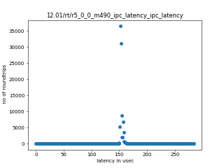
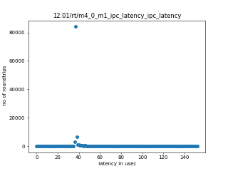
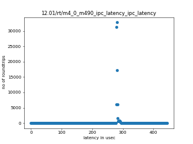

.. include:: <isonum.txt>

###################################
RT-linux 12.02.00 Performance Guide
###################################

***************
Read This First
***************

**All performance numbers provided in this document are gathered using
following Evaluation Modules unless otherwise specified.**

+----------------+---------------------------------------------------------------------------------------------------------------------+
| Name           | Description                                                                                                         |
+================+=====================================================================================================================+
| AM64x EVM      | AM64x Evaluation Module rev E1 with ARM running at 1GHz, DDR data rate 1600 MT/S                                    |
+----------------+---------------------------------------------------------------------------------------------------------------------+

Table:  Evaluation Modules

.. rubric::  About This Manual
   :name: about-this-manual-rt-kernel-perf-guide

This document provides performance data for each of the device drivers
which are part of the Processor SDK Linux package. This document should be
used in conjunction with release notes and user guides provided with the
Processor SDK Linux package for information on specific issues present
with drivers included in a particular release.

.. rubric::  If You Need Assistance
   :name: if-you-need-assistance-rt-kernel-perf-guide

For further information or to report any problems, contact
https://e2e.ti.com/ or https://support.ti.com/

*****************
System Benchmarks
*****************

LMBench
=======

LMBench is a collection of microbenchmarks of which the memory bandwidth
and latency related ones are typically used to estimate processor
memory system performance. More information about lmbench at
https://lmbench.sourceforge.net/whatis_lmbench.html and
https://lmbench.sourceforge.net/man/lmbench.8.html

**Latency**: :command:`lat_mem_rd-stride128-szN`, where N is equal to or smaller than the cache
size at given level measures the cache miss penalty. N that is at least
double the size of last level cache is the latency to external memory.

**Bandwidth**: :command:`bw_mem_bcopy-N`, where N is equal to or smaller than the cache size at
a given level measures the achievable memory bandwidth from software doing
a memcpy() type operation. Typical use is for external memory bandwidth
calculation. The bandwidth is calculated as byte read and written counts
as 1 which should be roughly half of STREAM copy result.

Execute the LMBench with the following:

.. code-block:: console

    cd /opt/ltp
    ./runltp -P j721e-idk-gw -f ddt/lmbench -s LMBENCH_L_PERF_0001

.. csv-table:: LMBench Benchmarks
   :header: "Benchmarks","am64xx-hsevm: perf"

   "af_unix_sock_stream_latency (microsec)","30.20 (min 29.18, max 34.39)"
   "af_unix_socket_stream_bandwidth (mb\s)","623.81 (min 611.93, max 634.06)"
   "bw_file_rd-io-1mb (mb/s)","859.73 (min 856.16, max 865.50)"
   "bw_file_rd-o2c-1mb (mb/s)","498.72 (min 492.05, max 502.01)"
   "bw_mem-bcopy-16mb (mb/s)","950.08 (min 907.65, max 974.72)"
   "bw_mem-bcopy-1mb (mb/s)","927.57 (min 900.74, max 955.72)"
   "bw_mem-bcopy-2mb (mb/s)","939.70 (min 912.13, max 955.41)"
   "bw_mem-bcopy-4mb (mb/s)","953.11 (min 904.77, max 1011.76)"
   "bw_mem-bcopy-8mb (mb/s)","938.51 (min 923.89, max 979.07)"
   "bw_mem-bzero-16mb (mb/s)","2117.14 (min 2111.93, max 2118.92)"
   "bw_mem-bzero-1mb (mb/s)","1522.80 (min 900.74, max 2120.14)"
   "bw_mem-bzero-2mb (mb/s)","1528.63 (min 912.13, max 2119.77)"
   "bw_mem-bzero-4mb (mb/s)","1535.15 (min 904.77, max 2118.27)"
   "bw_mem-bzero-8mb (mb/s)","1528.28 (min 923.89, max 2118.92)"
   "bw_mem-cp-16mb (mb/s)","581.33 (min 525.04, max 608.46)"
   "bw_mem-cp-1mb (mb/s)","1616.40 (min 573.72, max 2723.74)"
   "bw_mem-cp-2mb (mb/s)","1441.13 (min 520.22, max 2377.18)"
   "bw_mem-cp-4mb (mb/s)","1394.62 (min 520.77, max 2230.90)"
   "bw_mem-cp-8mb (mb/s)","1347.31 (min 529.14, max 2160.99)"
   "bw_mem-fcp-16mb (mb/s)","1076.29 (min 989.92, max 1143.51)"
   "bw_mem-fcp-1mb (mb/s)","1602.55 (min 1042.21, max 2120.14)"
   "bw_mem-fcp-2mb (mb/s)","1571.29 (min 974.98, max 2119.77)"
   "bw_mem-fcp-4mb (mb/s)","1580.83 (min 953.86, max 2118.27)"
   "bw_mem-fcp-8mb (mb/s)","1583.75 (min 999.13, max 2118.92)"
   "bw_mem-frd-16mb (mb/s)","1317.66 (min 1282.36, max 1344.09)"
   "bw_mem-frd-1mb (mb/s)","1200.63 (min 1042.21, max 1350.44)"
   "bw_mem-frd-2mb (mb/s)","1173.17 (min 974.98, max 1355.01)"
   "bw_mem-frd-4mb (mb/s)","1191.79 (min 953.86, max 1371.51)"
   "bw_mem-frd-8mb (mb/s)","1197.97 (min 999.13, max 1370.57)"
   "bw_mem-fwr-16mb (mb/s)","2120.71 (min 2109.43, max 2131.34)"
   "bw_mem-fwr-1mb (mb/s)","1977.92 (min 1294.62, max 2723.74)"
   "bw_mem-fwr-2mb (mb/s)","1825.45 (min 1272.67, max 2377.18)"
   "bw_mem-fwr-4mb (mb/s)","1775.55 (min 1314.06, max 2230.90)"
   "bw_mem-fwr-8mb (mb/s)","1747.28 (min 1306.12, max 2160.99)"
   "bw_mem-rd-16mb (mb/s)","1346.28 (min 1307.72, max 1388.29)"
   "bw_mem-rd-1mb (mb/s)","1101.21 (min 825.76, max 1375.28)"
   "bw_mem-rd-2mb (mb/s)","1085.06 (min 784.72, max 1391.55)"
   "bw_mem-rd-4mb (mb/s)","1083.08 (min 829.53, max 1401.79)"
   "bw_mem-rd-8mb (mb/s)","1129.14 (min 856.07, max 1405.23)"
   "bw_mem-rdwr-16mb (mb/s)","884.74 (min 873.46, max 890.17)"
   "bw_mem-rdwr-1mb (mb/s)","701.68 (min 573.72, max 823.72)"
   "bw_mem-rdwr-2mb (mb/s)","683.13 (min 520.22, max 821.02)"
   "bw_mem-rdwr-4mb (mb/s)","708.17 (min 520.77, max 857.54)"
   "bw_mem-rdwr-8mb (mb/s)","710.43 (min 529.14, max 887.41)"
   "bw_mem-wr-16mb (mb/s)","896.78 (min 888.64, max 906.21)"
   "bw_mem-wr-1mb (mb/s)","836.19 (min 783.33, max 897.99)"
   "bw_mem-wr-2mb (mb/s)","820.99 (min 784.72, max 866.68)"
   "bw_mem-wr-4mb (mb/s)","848.59 (min 809.39, max 874.41)"
   "bw_mem-wr-8mb (mb/s)","881.27 (min 855.07, max 903.44)"
   "bw_mmap_rd-mo-1mb (mb/s)","1299.18 (min 1247.08, max 1340.93)"
   "bw_mmap_rd-o2c-1mb (mb/s)","504.84 (min 493.75, max 522.47)"
   "bw_pipe (mb/s)","599.76 (min 589.92, max 623.28)"
   "bw_unix (mb/s)","623.81 (min 611.93, max 634.06)"
   "lat_connect (us)","70.26 (min 69.25, max 71.64)"
   "lat_ctx-2-128k (us)","26.02 (min 22.77, max 29.95)"
   "lat_ctx-2-256k (us)","82.04 (min 13.25, max 135.71)"
   "lat_ctx-4-128k (us)","65.95 (min 6.56, max 79.96)"
   "lat_ctx-4-256k (us)","121.54 (min 9.73, max 144.75)"
   "lat_fs-0k (num_files)","203.63 (min 197.00, max 217.00)"
   "lat_fs-10k (num_files)","91.38 (min 79.00, max 97.00)"
   "lat_fs-1k (num_files)","140.63 (min 133.00, max 172.00)"
   "lat_fs-4k (num_files)","129.13 (min 113.00, max 136.00)"
   "lat_mem_rd-stride128-sz1000k (ns)","46.71 (min 46.57, max 46.84)"
   "lat_mem_rd-stride128-sz125k (ns)","7.83 (min 7.79, max 7.91)"
   "lat_mem_rd-stride128-sz250k (ns)","12.69 (min 10.23, max 15.29)"
   "lat_mem_rd-stride128-sz31k (ns)","4.45 (min 3.06, max 5.89)"
   "lat_mem_rd-stride128-sz50 (ns)","3.02"
   "lat_mem_rd-stride128-sz500k (ns)","42.35 (min 41.66, max 42.92)"
   "lat_mem_rd-stride128-sz62k (ns)","7.32 (min 6.76, max 7.43)"
   "lat_mmap-1m (us)","63.25 (min 58.00, max 71.00)"
   "lat_ops-double-add (ns)","4.02"
   "lat_ops-double-div (ns)","22.13 (min 22.11, max 22.15)"
   "lat_ops-double-mul (ns)","4.02"
   "lat_ops-float-add (ns)","4.02 (min 4.02, max 4.03)"
   "lat_ops-float-div (ns)","13.07 (min 13.06, max 13.10)"
   "lat_ops-float-mul (ns)","4.02"
   "lat_ops-int-add (ns)","1.01"
   "lat_ops-int-bit (ns)","0.67"
   "lat_ops-int-div (ns)","6.03"
   "lat_ops-int-mod (ns)","6.37 (min 6.37, max 6.39)"
   "lat_ops-int-mul (ns)","4.27 (min 4.27, max 4.28)"
   "lat_ops-int64-add (ns)","1.01"
   "lat_ops-int64-bit (ns)","0.67"
   "lat_ops-int64-div (ns)","9.55 (min 9.55, max 9.57)"
   "lat_ops-int64-mod (ns)","7.38 (min 7.37, max 7.38)"
   "lat_ops-int64-mul (ns)","5.02 (min 4.98, max 5.10)"
   "lat_pagefault (us)","1.64 (min 1.53, max 1.68)"
   "lat_pipe (us)","16.62 (min 15.97, max 16.92)"
   "lat_proc-exec (us)","1156.15 (min 1128.60, max 1179.60)"
   "lat_proc-fork (us)","1012.56 (min 985.33, max 1031.17)"
   "lat_proc-proccall (us)","0.01"
   "lat_select (us)","42.83 (min 42.60, max 42.90)"
   "lat_sem (us)","1.99 (min 1.53, max 2.31)"
   "lat_sig-catch (us)","5.77 (min 5.64, max 5.87)"
   "lat_sig-install (us)","0.83 (min 0.80, max 0.88)"
   "lat_sig-prot (us)","0.84 (min 0.67, max 0.96)"
   "lat_syscall-fstat (us)","2.33 (min 2.28, max 2.43)"
   "lat_syscall-null (us)","0.42 (min 0.40, max 0.44)"
   "lat_syscall-open (us)","364.25 (min 322.33, max 401.36)"
   "lat_syscall-read (us)","0.69"
   "lat_syscall-stat (us)","5.98 (min 5.70, max 6.11)"
   "lat_syscall-write (us)","0.65 (min 0.64, max 0.65)"
   "lat_tcp (us)","0.78 (min 0.74, max 0.79)"
   "lat_unix (us)","30.20 (min 29.18, max 34.39)"
   "latency_for_0.50_mb_block_size (nanosec)","42.35 (min 41.66, max 42.92)"
   "latency_for_1.00_mb_block_size (nanosec)","23.35 (min 0.00, max 46.84)"
   "pipe_bandwidth (mb\s)","599.76 (min 589.92, max 623.28)"
   "pipe_latency (microsec)","16.62 (min 15.97, max 16.92)"
   "procedure_call (microsec)","0.01"
   "select_on_200_tcp_fds (microsec)","42.83 (min 42.60, max 42.90)"
   "semaphore_latency (microsec)","1.99 (min 1.53, max 2.31)"
   "signal_handler_latency (microsec)","0.83 (min 0.80, max 0.88)"
   "signal_handler_overhead (microsec)","5.77 (min 5.64, max 5.87)"
   "tcp_ip_connection_cost_to_localhost (microsec)","70.26 (min 69.25, max 71.64)"
   "tcp_latency_using_localhost (microsec)","0.78 (min 0.74, max 0.79)"

Dhrystone
=========

Dhrystone is a core only benchmark that runs from warm L1 caches in all
modern processors. It scales linearly with clock speed.

Please take note, different run may produce different slightly results.
This is advised to run this test multiple times in order to get maximum
performance numbers.

Execute the benchmark with the following:

.. code-block:: console

    runDhrystone

.. csv-table:: Dhrystone Benchmarks
   :header: "Benchmarks","am64xx-hsevm: perf"

   "cpu_clock (mhz)","1000.00"
   "dhrystone_per_mhz (dmips/mhz)","2.73 (min 2.60, max 2.80)"
   "dhrystone_per_second (dhrystonep)","4791616.25 (min 4651163.00, max 4878049.00)"

Whetstone
=========

Whetstone is a benchmark primarily measuring floating-point arithmetic performance.

Execute the benchmark with the following:

.. code-block:: console

    runWhetstone

.. csv-table:: Whetstone Benchmarks
   :header: "Benchmarks","am64xx-hsevm: perf"

   "whetstone (mips)","3809.50 (min 3333.30, max 5000.00)"

Linpack
=======

Linpack measures peak double precision (64 bit) floating point performance in
solving a dense linear system.

.. csv-table:: Linpack Benchmarks
   :header: "Benchmarks","am64xx-hsevm: perf"

   "linpack (kflops)","410855.00 (min 408925.00, max 412462.00)"

CoreMarkPro
===========

CoreMark\ |reg|-Pro is a comprehensive, advanced processor benchmark that works
with and enhances the market-proven industry-standard EEMBC CoreMark\ |reg|
benchmark. While CoreMark stresses the CPU pipeline, CoreMark-Pro tests the
entire processor, adding comprehensive support for multicore technology, a
combination of integer and floating-point workloads, and data sets for utilizing
larger memory subsystems.

.. csv-table:: CoreMarkPro Benchmarks
   :header: "Benchmarks","am64xx-hsevm: perf"

   "cjpeg-rose7-preset (workloads/)","29.69 (min 29.50, max 29.76)"
   "core (workloads/)","0.21"
   "coremark-pro ()","597.81 (min 591.79, max 601.48)"
   "linear_alg-mid-100x100-sp (workloads/)","10.42 (min 10.42, max 10.43)"
   "loops-all-mid-10k-sp (workloads/)","0.48 (min 0.48, max 0.49)"
   "nnet_test (workloads/)","0.76 (min 0.76, max 0.77)"
   "parser-125k (workloads/)","5.83 (min 5.32, max 6.06)"
   "radix2-big-64k (workloads/)","21.26 (min 21.14, max 21.36)"
   "sha-test (workloads/)","57.71 (min 57.47, max 57.80)"
   "zip-test (workloads/)","15.98 (min 15.63, max 16.13)"

.. csv-table:: CoreMarkProTwoCore Benchmarks
   :header: "Benchmarks","am64xx-hsevm: perf"

   "cjpeg-rose7-preset (workloads/)","57.10 (min 51.81, max 58.48)"
   "core (workloads/)","0.43"
   "coremark-pro ()","1023.00 (min 961.90, max 1079.70)"
   "linear_alg-mid-100x100-sp (workloads/)","20.80 (min 20.75, max 20.84)"
   "loops-all-mid-10k-sp (workloads/)","0.89 (min 0.88, max 0.90)"
   "nnet_test (workloads/)","1.53 (min 1.52, max 1.53)"
   "parser-125k (workloads/)","5.93 (min 3.77, max 7.30)"
   "radix2-big-64k (workloads/)","32.97 (min 31.95, max 34.19)"
   "sha-test (workloads/)","115.11 (min 113.64, max 116.28)"
   "zip-test (workloads/)","23.73 (min 14.71, max 29.41)"

MultiBench
==========

MultiBench\ |trade| is a suite of benchmarks that allows processor and system
designers to analyze, test, and improve multicore processors. It uses three
forms of concurrency: Data decomposition: multiple threads cooperating on
achieving a unified goal and demonstrating a processor's support for fine grain
parallelism.
Processing multiple data streams: uses common code running over multiple threads and
demonstrating how well a processor scales over scalable data inputs.
Multiple workload processing: shows the scalability of general-purpose processing,
demonstrating concurrency over both code and data.
MultiBench combines a wide variety of application-specific workloads with the EEMBC
Multi-Instance-Test Harness (MITH), compatible and portable with most any multicore
processors and operating systems. MITH uses a thread-based API (POSIX-compliant) to
establish a common programming model that communicates with the benchmark through an
abstraction layer and provides a flexible interface to allow a wide variety of
thread-enabled workloads to be tested.

.. csv-table:: Multibench Benchmarks
   :header: "Benchmarks","am64xx-hsevm: perf"

   "4m-check (workloads/)","287.01 (min 286.53, max 288.15)"
   "4m-check-reassembly (workloads/)","81.86 (min 79.11, max 82.92)"
   "4m-check-reassembly-tcp (workloads/)","34.95 (min 31.21, max 37.65)"
   "4m-check-reassembly-tcp-cmykw2-rotatew2 (workloads/)","14.57 (min 14.45, max 14.72)"
   "4m-check-reassembly-tcp-x264w2 (workloads/)","0.75"
   "4m-cmykw2 (workloads/)","84.07 (min 83.23, max 85.11)"
   "4m-cmykw2-rotatew2 (workloads/)","17.32 (min 16.66, max 18.26)"
   "4m-reassembly (workloads/)","93.73 (min 93.37, max 94.34)"
   "4m-rotatew2 (workloads/)","18.86 (min 18.01, max 20.27)"
   "4m-tcp-mixed (workloads/)","61.26 (min 45.33, max 84.66)"
   "4m-x264w2 (workloads/)","0.76 (min 0.76, max 0.77)"
   "empty-wld (workloads/)","1.00"
   "idct-4m (workloads/)","13.98 (min 13.96, max 13.99)"
   "idct-4mw1 (workloads/)","13.98 (min 13.97, max 13.99)"
   "ippktcheck-4m (workloads/)","288.40 (min 287.09, max 289.55)"
   "ippktcheck-4mw1 (workloads/)","288.85 (min 287.65, max 289.86)"
   "ipres-4m (workloads/)","72.88 (min 72.43, max 73.46)"
   "ipres-4mw1 (workloads/)","72.72 (min 72.25, max 73.46)"
   "md5-4m (workloads/)","20.16 (min 19.95, max 20.38)"
   "md5-4mw1 (workloads/)","20.34 (min 20.16, max 20.64)"
   "rgbcmyk-4m (workloads/)","45.00 (min 44.95, max 45.05)"
   "rgbcmyk-4mw1 (workloads/)","44.96 (min 44.91, max 45.01)"
   "rotate-4ms1 (workloads/)","16.74 (min 16.67, max 16.80)"
   "rotate-4ms1w1 (workloads/)","16.72 (min 16.57, max 16.80)"
   "rotate-4ms64 (workloads/)","16.91 (min 16.81, max 16.96)"
   "rotate-4ms64w1 (workloads/)","16.93 (min 16.90, max 17.01)"
   "x264-4mq (workloads/)","0.41"
   "x264-4mqw1 (workloads/)","0.41"

*********************
Boot-time Measurement
*********************

Boot media: MMCSD
=================

.. csv-table:: Linux boot time MMCSD
   :header: "Boot Configuration","am64xx-hsevm: Boot time in seconds: avg(min,max)"

   "Linux boot time from SD with default rootfs (20 boot cycles)","29.35 (min 23.30, max 35.36)"

Boot time numbers [avg, min, max] are measured from "Starting kernel" to Linux prompt across 20 boot cycles.

***********************
Linux OSPI Flash Driver
***********************

.. rubric:: AM64XX-EVM
   :name: am64xx-evm-ospi

.. rubric:: RAW
   :name: am64xx-evm-ospi-raw

.. csv-table:: OSPI Raw Flash Driver
   :header: "File size (Mbytes)","am64xx-hsevm: Raw Read Throughput (Mbytes/sec)"

   "50","141.90 (min 138.89, max 147.06)"

***********
EMMC Driver
***********

.. warning::

  **IMPORTANT**: The performance numbers can be severely affected if the media is
  mounted in sync mode. Hot plug scripts in the filesystem mount
  removable media in sync mode to ensure data integrity. For performance
  sensitive applications, umount the auto-mounted filesystem and
  re-mount in async mode.

EMMC EXT4 FIO 1G
================

.. csv-table:: EMMC EXT4 FIO 1G
   :header: "Buffer size (bytes)","am64xx-hsevm: Write EXT4 Throughput (Mbytes/sec)","am64xx-hsevm: Write EXT4 CPU Load (%)","am64xx-hsevm: Read EXT4 Throughput (Mbytes/sec)","am64xx-hsevm: Read EXT4 CPU Load (%)"

   "1m","59.75 (min 57.50, max 61.60)","4.10 (min 3.77, max 4.55)","175.00","7.83 (min 6.89, max 8.84)"
   "4m","59.40 (min 56.50, max 61.60)","3.15 (min 2.86, max 3.39)","174.38 (min 174.00, max 175.00)","6.44 (min 5.57, max 7.21)"
   "4k","51.29 (min 50.80, max 51.60)","44.91 (min 42.77, max 47.86)","55.74 (min 55.10, max 56.40)","38.66 (min 37.82, max 39.85)"
   "256k","59.68 (min 57.30, max 61.60)","5.85 (min 5.38, max 6.15)","174.00","8.77 (min 7.94, max 9.34)"

EMMC EXT4
=========

.. csv-table:: EMMC EXT4
   :header: "Buffer size (bytes)","am64xx-hsevm: Write EXT4 Throughput (Mbytes/sec)","am64xx-hsevm: Write EXT4 CPU Load (%)","am64xx-hsevm: Read EXT4 Throughput (Mbytes/sec)","am64xx-hsevm: Read EXT4 CPU Load (%)"

   "102400","52.53 (min 47.35, max 55.82)","10.93 (min 9.37, max 20.00)","176.62 (min 170.03, max 179.00)","27.01 (min 26.32, max 27.52)"
   "262144","52.64 (min 47.32, max 54.82)","10.72 (min 9.30, max 15.11)","182.40 (min 182.09, max 182.52)","26.95 (min 25.69, max 29.09)"
   "524288","52.78 (min 48.06, max 55.53)","10.82 (min 9.16, max 17.57)","182.89 (min 182.66, max 182.99)","26.02 (min 24.55, max 27.93)"
   "1048576","53.09 (min 48.17, max 55.69)","10.62 (min 9.00, max 14.89)","182.92 (min 182.65, max 183.08)","26.77 (min 25.45, max 28.18)"
   "5242880","53.42 (min 48.53, max 55.69)","10.43 (min 8.76, max 15.91)","182.85 (min 182.73, max 182.95)","28.40 (min 27.93, max 29.20)"

EMMC VFAT
=========

.. csv-table:: EMMC VFAT
   :header: "Buffer size (bytes)","am64xx-hsevm: Write VFAT Throughput (Mbytes/sec)","am64xx-hsevm: Write VFAT CPU Load (%)","am64xx-hsevm: Read VFAT Throughput (Mbytes/sec)","am64xx-hsevm: Read VFAT CPU Load (%)"

   "102400","48.36 (min 35.66, max 53.64)","15.17 (min 11.01, max 45.70)","168.12 (min 160.22, max 169.66)","28.59 (min 27.43, max 29.31)"
   "262144","48.44 (min 38.65, max 52.84)","13.25 (min 11.03, max 19.81)","168.83 (min 160.66, max 171.03)","29.11 (min 27.78, max 31.03)"
   "524288","48.46 (min 38.61, max 53.62)","13.29 (min 10.96, max 19.62)","165.51 (min 149.21, max 169.28)","26.06 (min 25.00, max 27.54)"
   "1048576","48.52 (min 38.86, max 52.94)","13.29 (min 10.96, max 19.62)","165.96 (min 155.75, max 169.69)","26.61 (min 24.17, max 28.10)"
   "5242880","48.71 (min 39.02, max 53.43)","13.24 (min 10.85, max 19.88)","165.03 (min 152.15, max 168.89)","27.92 (min 27.27, max 28.69)"

*****************
UBoot EMMC Driver
*****************

.. csv-table:: UBOOT EMMC RAW
   :header: "File size (bytes in hex)","am64xx-hsevm: Write Throughput (Kbytes/sec)","am64xx-hsevm: Read Throughput (Kbytes/sec)"

   "2000000","59099.78 (min 56987.83, max 60794.06)","168690.67 (min 168041.03, max 168907.22)"
   "4000000","60089.49 (min 58254.22, max 61768.14)","172633.80 (min 172463.16, max 172918.21)"

*****
MMCSD
*****

.. warning::

  **IMPORTANT**: The performance numbers can be severely affected if the media is
  mounted in sync mode. Hot plug scripts in the filesystem mount
  removable media in sync mode to ensure data integrity. For performance
  sensitive applications, umount the auto-mounted filesystem and
  re-mount in async mode.

MMC EXT4 FIO 1G
===============

.. csv-table:: MMC EXT4 FIO 1G
   :header: "Buffer size (bytes)","am64xx-hsevm: Write EXT4 Throughput (Mbytes/sec)","am64xx-hsevm: Write EXT4 CPU Load (%)","am64xx-hsevm: Read EXT4 Throughput (Mbytes/sec)","am64xx-hsevm: Read EXT4 CPU Load (%)"

   "1m","42.57 (min 41.90, max 43.00)","3.62 (min 3.36, max 3.95)","86.60 (min 85.00, max 87.20)","5.27 (min 4.86, max 5.46)"
   "4m","41.36 (min 39.90, max 42.70)","2.83 (min 2.59, max 3.12)","86.27 (min 84.40, max 87.30)","3.77 (min 3.15, max 4.49)"
   "4k","2.81 (min 2.77, max 2.87)","6.95 (min 6.58, max 7.36)","12.86 (min 12.70, max 13.00)","12.23 (min 11.73, max 13.34)"
   "256k","38.76 (min 37.70, max 40.50)","4.82 (min 4.56, max 5.06)","83.54 (min 82.90, max 84.00)","6.30 (min 5.95, max 6.61)"

MMC EXT4
========

.. csv-table:: MMC EXT4
   :header: "Buffer size (bytes)","am64xx-hsevm: Write Raw Throughput (Mbytes/sec)","am64xx-hsevm: Write Raw CPU Load (%)","am64xx-hsevm: Read Raw Throughput (Mbytes/sec)","am64xx-hsevm: Read Raw CPU Load (%)"

   "102400","30.03 (min 27.19, max 32.05)","6.26 (min 4.69, max 9.60)","39.71 (min 38.27, max 42.70)","6.71 (min 6.30, max 7.05)"
   "262144","28.81 (min 27.47, max 31.11)","6.16 (min 5.12, max 8.82)","42.17 (min 39.48, max 44.55)","6.41 (min 5.83, max 7.08)"
   "524288","29.37 (min 27.33, max 31.97)","6.00 (min 4.74, max 8.93)","45.49 (min 45.07, max 45.65)","6.60 (min 6.36, max 7.03)"
   "1048576","29.80 (min 28.48, max 32.63)","6.15 (min 4.89, max 11.83)","45.48 (min 45.24, max 45.62)","6.77 (min 6.37, max 7.22)"
   "5242880","29.92 (min 28.63, max 33.11)","5.91 (min 4.79, max 9.62)","45.59 (min 45.46, max 45.66)","6.95 (min 6.61, max 7.24)"

The performance numbers were captured using the following:

-  SanDisk Max Endurance SD card (SDSQQVR-032G-GN6IA)
-  Partition was mounted with async option

*************
CRYPTO Driver
*************

OpenSSL Performance
===================

.. csv-table:: OpenSSL Performance
   :header: "Algorithm","Buffer Size (in bytes)","am64xx-hsevm: throughput (KBytes/Sec)"

   "aes-128-cbc","1024","22657.28 (min 22446.76, max 22984.02)"
   "aes-128-cbc","16","369.25 (min 346.82, max 386.60)"
   "aes-128-cbc","16384","144784.73 (min 144282.97, max 145058.47)"
   "aes-128-cbc","256","6790.35 (min 6187.86, max 6911.57)"
   "aes-128-cbc","64","1677.61 (min 1535.96, max 1736.68)"
   "aes-128-cbc","8192","107443.88 (min 106793.64, max 107973.29)"
   "aes-128-ecb","1024","23112.49 (min 22763.86, max 23460.52)"
   "aes-128-ecb","16","370.65 (min 353.96, max 395.04)"
   "aes-128-ecb","16384","149158.57 (min 147625.30, max 150700.03)"
   "aes-128-ecb","256","6730.73 (min 6198.36, max 7139.93)"
   "aes-128-ecb","64","1696.02 (min 1533.06, max 1786.58)"
   "aes-128-ecb","8192","110338.05 (min 108300.97, max 111970.99)"
   "aes-192-cbc","1024","22190.59 (min 21196.80, max 22762.15)"
   "aes-192-cbc","16","367.94 (min 343.27, max 385.03)"
   "aes-192-cbc","16384","135482.03 (min 134933.16, max 135932.59)"
   "aes-192-cbc","256","6694.22 (min 6094.68, max 6916.27)"
   "aes-192-cbc","64","1672.61 (min 1523.18, max 1734.74)"
   "aes-192-cbc","8192","102529.71 (min 101761.02, max 103170.05)"
   "aes-192-ecb","1024","22661.25 (min 21540.52, max 23215.45)"
   "aes-192-ecb","16","374.44 (min 353.26, max 392.62)"
   "aes-192-ecb","16384","140632.75 (min 139586.22, max 141617.83)"
   "aes-192-ecb","256","6807.13 (min 6140.84, max 7107.67)"
   "aes-192-ecb","64","1708.10 (min 1539.52, max 1785.83)"
   "aes-192-ecb","8192","105539.93 (min 104278.70, max 106018.13)"
   "aes-256-cbc","1024","22275.58 (min 21713.92, max 22521.86)"
   "aes-256-cbc","16","372.59 (min 353.18, max 386.12)"
   "aes-256-cbc","16384","127464.79 (min 126844.93, max 128341.33)"
   "aes-256-cbc","256","6854.95 (min 6727.17, max 6908.50)"
   "aes-256-cbc","64","1711.54 (min 1642.20, max 1745.28)"
   "aes-256-cbc","8192","97937.07 (min 97006.93, max 98620.76)"
   "aes-256-ecb","1024","22479.91 (min 21417.30, max 23324.33)"
   "aes-256-ecb","16","371.43 (min 353.35, max 397.03)"
   "aes-256-ecb","16384","131680.94 (min 131230.38, max 132530.18)"
   "aes-256-ecb","256","6835.85 (min 6191.79, max 7118.76)"
   "aes-256-ecb","64","1669.31 (min 1549.55, max 1788.03)"
   "aes-256-ecb","8192","99921.92 (min 99013.97, max 100777.98)"
   "sha256","1024","24025.26 (min 23861.59, max 24406.36)"
   "sha256","16","399.71 (min 396.52, max 405.19)"
   "sha256","16384","202704.21 (min 201708.89, max 204182.87)"
   "sha256","256","6255.45 (min 6207.66, max 6359.64)"
   "sha256","64","1581.70 (min 1569.15, max 1607.40)"
   "sha256","8192","134481.24 (min 133666.13, max 135872.51)"
   "sha512","1024","19811.11 (min 19703.81, max 19945.81)"
   "sha512","16","387.23 (min 385.53, max 389.84)"
   "sha512","16384","78793.39 (min 78402.90, max 79047.34)"
   "sha512","256","5813.40 (min 5782.70, max 5846.36)"
   "sha512","64","1547.97 (min 1540.71, max 1558.04)"
   "sha512","8192","65513.13 (min 65385.81, max 65702.57)"

.. csv-table:: OpenSSL CPU Load
   :header: "Algorithm","am64xx-hsevm: CPU Load"

   "aes-128-cbc","44.13 (min 43.00, max 45.00)"
   "aes-128-ecb","46.00 (min 45.00, max 47.00)"
   "aes-192-cbc","44.50 (min 43.00, max 46.00)"
   "aes-192-ecb","45.38 (min 43.00, max 47.00)"
   "aes-256-cbc","44.25 (min 43.00, max 45.00)"
   "aes-256-ecb","44.38 (min 44.00, max 46.00)"
   "sha256","97.00 (min 94.00, max 98.00)"
   "sha512","97.00 (min 94.00, max 98.00)"

Listed for each algorithm are the code snippets used to run each
  benchmark test.

.. code-block:: console

    time -v openssl speed -elapsed -evp aes-128-cbc

***********
MCAN Driver
***********

MCAN Latency External Loopback
==============================

.. csv-table:: MCAN Latency External Loopback
   :header: "Benchmark","am64xx-hsevm: Max Latency (µs)","am64xx-hsevm: Avg Latency (µs)"

   "MAIN_MCAN0_TO_MAIN_MCAN1_250000","27522.00 (min 26281.00, max 28060.00)","9756.82 (min 9358.00, max 10093.00)"
   "MAIN_MCAN0_TO_MAIN_MCAN1_CANFD_2M_5M","27280.45 (min 26258.00, max 28089.00)","9244.18 (min 8965.00, max 9689.00)"

RP Message Inter-Processor Communication (IPC) Latency
--------------------------------------------------------

RP Message latency Performance
^^^^^^^^^^^^^^^^^^^^^^^^^^^^^^

RP Message latency is the delay measured from sending a round trip echo message from
a Linux application to a remote processor and back. The following measurements use
a RP message length of 1 byte and 490 bytes for comparison.

The Linux user space application `rpmsg_char_benchmark <https://git.ti.com/cgit/rpmsg/ti-rpmsg-char/>`__ captures these latency values.

Test commands used for running IPC latency tests:

.. code:: console

   rpmsg_char_benchmark -r 2 -n 100000 -m 1 & chrt -f -p 80 $!

Latencies reported:

.. csv-table::
   :header: "Remote Processor","Message Size (in bytes)","Average round trip (usecs)","Max round trip (usecs)"

   "R5F0_0","1","26","149"
   "R5F0_0","490","153","284"
   "M4F","1","37","152"
   "M4F","490","281","444"

|